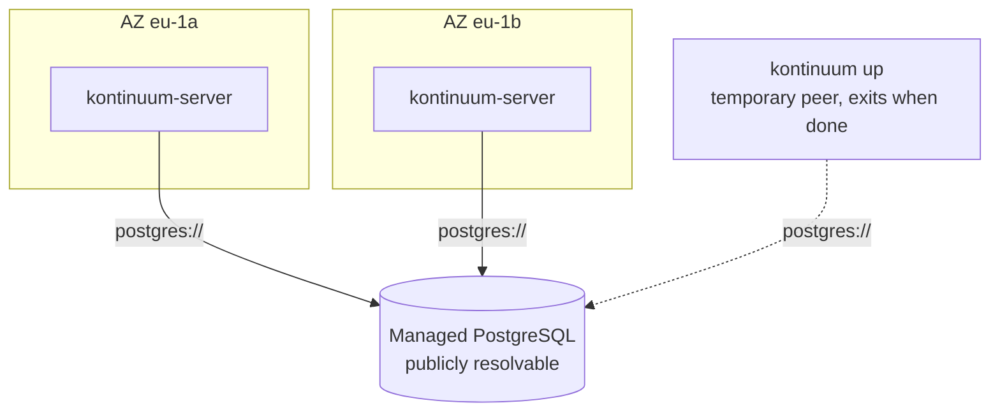
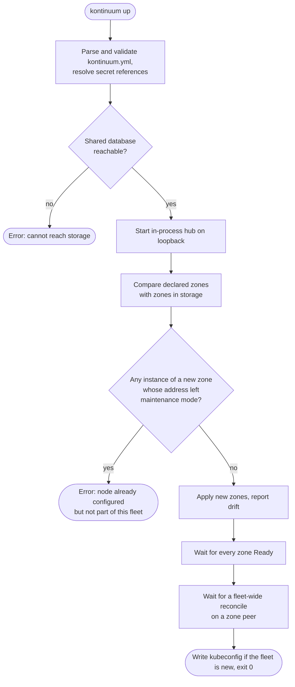

# Converge a fleet with `kontinuum up`

`kontinuum up` brings a whole fleet to the state a declarative `kontinuum.yml` describes. It's the same command whatever it finds:

- On fresh machines, it creates the fleet.
- After an interrupted run, it resumes.
- Against a running fleet, it adds missing zones and reports drift.
- With nothing to do, it's a no-op.

It never prompts, so it behaves the same in a terminal and in CI, and it never deletes anything unless you pass `--prune`.

`kontinuum up` supports [direct storage](../production-deployment.md#direct-mode): every zone, and `up` itself, connects straight to a shared, publicly reachable database. There is no hub. To run it from CI, see [GitHub Actions](../github-actions.md) for installing the CLI; running `up` from a workflow is tracked in [#168](https://github.com/nicklasfrahm-dev/kontinuum/issues/168).



## Prerequisites

- A PostgreSQL or MySQL database every zone, and the machine running `up`, can reach. Its hostname must resolve only to public addresses, or you set `spec.storage.mode: Direct` to say so (see [Storage modes](../reference.md#storage-modes)).
- At least two zones. A zone can't reconcile itself, so in a hub-less fleet each zone is reconciled by another.
- 1, 3 or 5 Talos nodes per zone, booted into maintenance mode and reachable from the machine running `up` on the Talos API port (`50000`).
- A DNS zone managed by a [DNS provider with a DNS-01 solver](../reference.md#dns-providers), and an identity provider with Kontinuum registered as a [public PKCE client](../authentication.md#registering-kontinuum-with-your-identity-provider), unless the fleet allows anonymous access.
- The `kontinuum` CLI of exactly the version the fleet declares in `spec.version`.

## `kontinuum.yml`

```yaml
apiVersion: up.kontinuum.sh/v1alpha1
kind: Fleet
metadata:
  name: example
spec:
  # Must equal the CLI's own version.
  version: v0.37.0

  frontend:
    # Where the UI is served. Every zone's OIDC redirect URL becomes
    # https://<host>/app, and the UI on a zone's own hostname redirects here.
    host: kontinuum.example.com

  storage:
    # The mode is inferred from the URI. Set it explicitly to override
    # inference, e.g. behind split-horizon DNS.
    # mode: Direct
    uri: ${env:KONTINUUM_STORAGE_URI}

  talos:
    version: v1.13.0
  kubernetes:
    version: v1.32.0

  dns:
    # Zones are published as <zone>.<region>.<domain>.
    domain: example.com
    provider: Cloudflare
    # Flat mapping of the environment variables the provider reads.
    credential:
      CF_API_TOKEN: ${env:CLOUDFLARE_API_TOKEN}

  acme:
    # The provider every zone's certificates are ordered from.
    provider: letsencrypt
    providers:
      letsencrypt:
        server: https://acme-v02.api.letsencrypt.org/directory
        email: ops@example.com
      letsencrypt-staging:
        server: https://acme-staging-v02.api.letsencrypt.org/directory
        email: ops@example.com
      zerossl:
        server: https://acme.zerossl.com/v2/DV90
        email: ops@example.com
        externalAccountBinding:
          keyID: ${env:ZEROSSL_EAB_KEY_ID}
          hmacKey: ${env:ZEROSSL_EAB_HMAC_KEY}

  auth:
    oidc:
      issuerURL: https://id.example.com
      # A public client: the login flow is PKCE, there is no client secret.
      clientID: kontinuum
      adminGroups:
        - platform-admins
    # Mutually exclusive with oidc.
    # insecureAllowAnonymous: true

  zones:
    - region: eu
      zone: eu-1a
      # Every instance joins the zone's control plane; use 1, 3 or 5.
      instances:
        - address: 203.0.113.10
        - address: 203.0.113.11
        - address: 203.0.113.12
    - region: eu
      zone: eu-1b
      instances:
        - address: 198.51.100.20
```

`kontinuum.yml` is the only source of the fleet's desired state: `up`'s flags only change how it runs. The file is never served by the apiserver, so `kubectl` users never go looking for a `Fleet` resource. The [reference](../reference.md#kontinuumyml) lists every field and rule.

Secrets are never written into the file. Every credential, and every other string you want to keep out of it, is a reference that `up` expands at runtime:

- `${env:NAME}` is the environment variable `NAME`. Unset or empty is an error, never an empty string.
- `${file:path}` is the file's contents with one trailing newline stripped. A relative path resolves against the file that declares it, so `up -f infra/kontinuum.yml` behaves the same from any directory.

Secret fields accept nothing but exactly one reference, so a committed `kontinuum.yml` can't leak one: `storage.uri`, every value under `dns.credential`, and every provider's `externalAccountBinding.hmacKey`.

## Overlays

`-f` takes several files, comma-separated or with the flag repeated, merged left to right with the right-most file winning. Keep shared settings in a base and each environment's differences in an overlay:

```text
infra/
├── kontinuum.yml           # versions, ACME, auth, storage mode
├── staging/kontinuum.yml   # frontend host, DNS domain, storage URI, zones
└── prod/kontinuum.yml
```

```sh
kontinuum up -f infra/kontinuum.yml,infra/prod/kontinuum.yml
```

```yaml
# infra/prod/kontinuum.yml
apiVersion: up.kontinuum.sh/v1alpha1
kind: Fleet
metadata:
  name: prod
spec:
  frontend:
    host: kontinuum.example.com
  dns:
    domain: example.com
  storage:
    uri: ${env:KONTINUUM_PROD_STORAGE_URI}
  zones:
    - region: eu
      zone: eu-1a
      instances:
        - address: 203.0.113.10
    - region: eu
      zone: eu-1b
      instances:
        - address: 198.51.100.20
```

The merge follows plain YAML structure, with no special cases per field:

- **Mappings merge key by key, recursively**, `dns.credential` and `acme.providers` included. A staging overlay only needs `acme: {provider: letsencrypt-staging}`.
- **Scalars are replaced** by the right-most file that sets them.
- **Sequences are replaced whole**, never merged or appended. An overlay that sets `zones` declares the environment's complete zone list.
- **`null` removes a field**, subtree included, as if no file had set it. For example, `acme: {providers: {zerossl: null}}` drops a provider the base declares. A `null` inside a list is an error.

Each file is checked on its own for `apiVersion`, `kind` and unknown fields, with errors naming the file. Everything else is checked on the merged result, so neither a base nor an overlay has to be a complete `Fleet` by itself. A reference an overlay overrides is never read.

## What `up` does



`up` is a temporary peer on the shared database. It starts an in-process hub, the same apiserver and controllers `serve` runs, bound to loopback. That hub never registers a `Kontinuum`, so nothing in the fleet mistakes it for a member. `up` applies the declared zones through it, waits, and exits. Its zone leases expire 45 seconds later, and the zone peers carry on.

- **Nothing is lost if `up` is killed.** Everything it writes lands in the shared database immediately, so re-running simply continues. That also makes ephemeral CI runners safe.
- **No fleet API credential is needed.** `up` talks to its own in-process apiserver. The cost is that whoever runs `up` holds the full database credential, as every zone does in direct mode.
- **Concurrent runs are safe.** Two `up`s against the same database are just two peers, serialised by the same leases as any others.
- **Unreachable storage is an error, never "no fleet".** `up` only concludes a fleet is new from a database it can read that has no zones.
- **New zones must be on maintenance-mode nodes.** Before creating anything, `up` checks every instance of every zone not yet in storage, and names each address that doesn't answer as a Talos node in maintenance mode. Such a node belongs to something else, or its state was lost.
- **Hand-off is proven, not assumed.** `up`'s own hub never takes the fleet-wide lease. So before exiting, `up` waits until a zone peer has renewed that lease, showing that fleet-wide work (the registry's stale-entry sweep, admin role bindings, the frontend host's DNS record) runs with `up` gone.
- **A kubeconfig is written only on creation.** When the run created the fleet, or resumed a creation an interrupted run started, `up` writes `--kubeconfig-out` (default `kubeconfig.yaml`, mode `0600`) with one context per zone, `<zone>.<region>.<domain>`. An existing file is never overwritten. The API stays on the zone hostnames even with a frontend host.

The CLI's version is the fleet's version: `up` runs its own controllers, and zones deploy the image of the version reconciling them, so `up` refuses to run when `spec.version` differs from the CLI's version. If the running fleet reports another version than `spec.version`, that is an upgrade, which `up` doesn't do. It reports it and applies zone objects only, without running its own controllers against a fleet running different controller code.

## Converge behaviour and drift

| Found | What `up` does |
| --- | --- |
| A zone in the file but not the fleet | Creates it the same way `zone add` does, with one seed `Instance` per `instances` entry, and waits for it to be `Ready`. |
| A zone in the fleet but not the file | Reports it. With `--prune`, removes it. |
| A declared zone in the fleet but not `Ready` yet, e.g. after an interrupted run | Runs its controllers and waits for it again. In a new fleet, nothing else may be able to reconcile it yet. |
| A zone whose `instances` differ | Reports drift, listing the added and missing addresses. Growing or shrinking a running zone's etcd cluster is not supported. |
| A different `spec.version`, or changed auth, ACME, DNS or frontend settings | Reports drift. Applying fleet-wide settings needs a fleet-wide configuration object in shared state, which is a follow-up. |
| Nothing | Prints that the fleet is up to date and exits `0`. |

`up` never deletes because a line was dropped from a file: deleting a zone resets its nodes. With `--prune`, a zone missing from the file is removed through the ordinary [zone remove](zone-remove.md) path, by deleting its `Zone` so the zone's finalizer tears it down.

`kontinuum up --dry-run` prints the merged `Fleet`, with references unexpanded and any key an overlay removed listed above it, followed by the plan. It changes nothing. It exits `2` when changes or drift are pending, so a scheduled dry run works as a drift alarm.

## `up` alongside `zone add`

Imperative changes still work: `kontinuum zone add` and the UI's "Add zone" form are fully supported against a fleet `up` manages. But a zone added that way isn't in `kontinuum.yml`. The next `up` reports it as drift, and `up --prune` removes it. Add the zone to the file to keep it.
